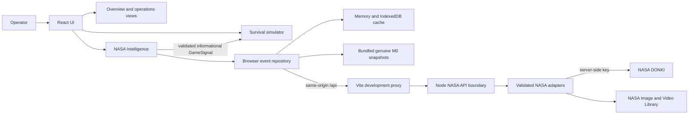

# LUNAR OPS architecture

## Boundaries

- Phase 1 dashboard demo state is in `src/data/simulatedMission.js`; its values are illustrative.
- Phase 2 calculations remain in `src/logic/`. NASA briefings cross into the game only as sanitized, zero-effect context signals.
- NASA transport, secrets, validation, provenance, offline snapshots and mapping rules stay separated by the modules described in `PHASE3_M2_M9.md`.
- `vite.config.js` proxies API requests only in development. Production requires a separately deployed API behind a trusted access-controlled reverse proxy; this repo does not specify a provider or deploy configuration.

## NASA view freshness

Per-kind repository requests are coalesced. Stale cached records appear immediately while a refresh runs. The view applies refresh results only when its current request generation is still active; a later mode/request wins, and cleanup invalidates the generation on unmount. If a category request rejects, the view retains results from successful categories and includes an `UNAVAILABLE` delivery state in its aggregate status. Repository fallback or refresh failures also produce a general notice. The current interface does not identify each failed event category individually. `NASA_LIVE`, `NASA_ARCHIVE`, `DERIVED`, and `SIMULATED` remain distinct provenance categories.
